手游的终点难道就是自动化吗？！继《明日方舟：终末地》的 MaaEnd，《鸣潮》的 OK WuWa 等自动化工具后，我又轻而易举翻到了《蔚蓝档案》的自动化工具 Blue Archive Aris Helper（BAAH）。嘛，大热游戏从来不缺人开发此类工具，我也只不过是犯了一条懒狗都会犯的错误罢了。

由于在国内游玩《蔚蓝档案》国际服的种种限制，加上相比 MaaEnd 和 OK WuWa，BAAH 的配置和使用略显复杂，我记录下这篇博客，也许对你有所帮助。

## 安装并配置 MuMu 模拟器

参考 BAAH 的官方文档，建议使用 MuMu 模拟器 4.x 版本。

因此访问 https://a11.gdl.netease.com/MuMuNG-setup-V4.1.33.3741-0717235142.exe 下载 MuMu 模拟器 4.x 版本并安装。

为了避免模拟器自动更新到最新版本，同时也防止不更新就不给用，修改 `~\AppData\Roaming\Netease\MuMuPlayer-12.0\configs\updater_config.json` 为以下内容：

```json
{
  "updater": {
    "version": {
      "force": "",
      "reminder": ""
    }
  }
}
```

保存后，在属性中设置此文件**只读**。这样，我们就能保证本机的 MuMu 模拟器固定在 4.x 版本而不更新了。

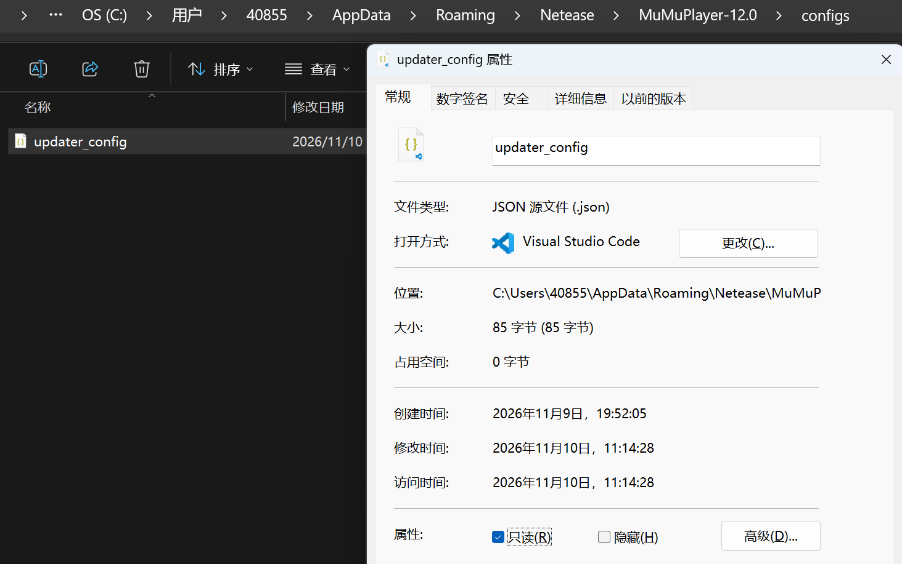

启动 MuMu 模拟器，按照 BAAH 官方文档的要求调整模拟器配置：

> 分辨率设置为 1280/\*720 像素， 240 DPI。将 ADB 调试打开。注意模拟器的 ADB 调试端口号。
> 如果你使用的是 MuMu 模拟器，请在设置的底部关闭后台保活运行。
> 如果 ADB 无法连接，请确认关闭模拟器的网络桥接功能或在其他设置中修改 ADB 连接 IP。

设置页面没有显式透出 ADB 调试的端口号，在模拟器右上角点击“菜单”-“问题诊断”方可看到当前分配的端口号，默认情况下为 `16384`。

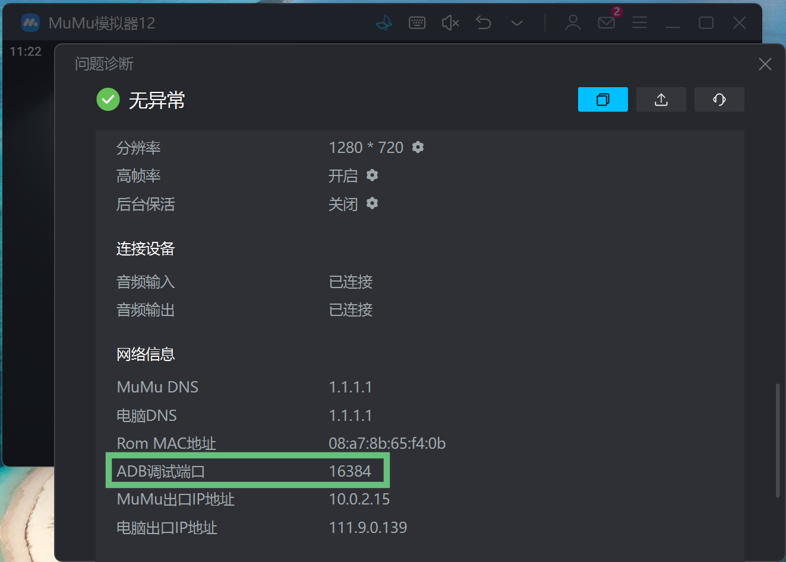

## 安装并配置《蔚蓝档案》国际服客户端

《蔚蓝档案》国际服需加速器才能游玩，因此我首先安装了自己常备的 UU 加速器。

我的游戏账号为 Google 账号，可以在模拟器的“游戏中心”里搜索“谷歌安装器”，通过它装上 Google 套组。


接着在 UU 加速器里搜索“KK谷歌助手”，加速后即可登录自己的 Google 账号。

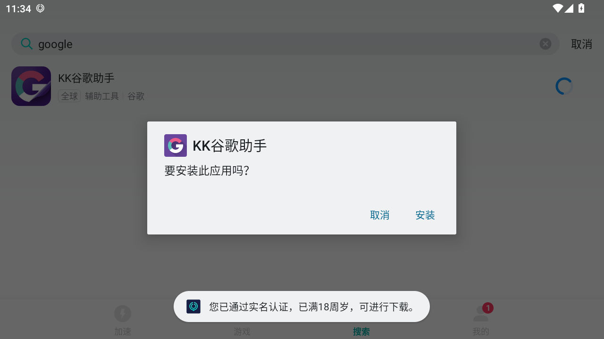

不过 Google Play 在登录后转半天没转出来，等得人心痒痒，于是切换到 QooApp 安装[《蔚蓝档案》国际服](https://apps.qoo-app.com/app/18698)客户端。

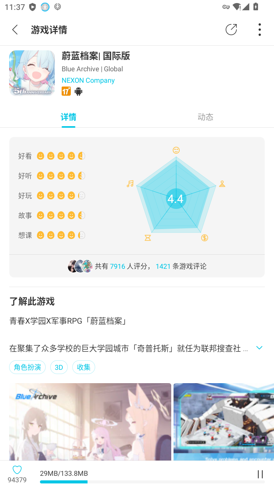

随后便是漫长的游戏资源包下载……饮口茶先……

游戏启动后，切换到自己习惯的语言，按照 BAAH 官方文档的要求调整游戏客户端配置：

> 游戏 -> 技能动画 -> 关
> 画面 -> 战斗时上下黑边 -> 关
> 咖啡厅的摄像机视角手动拉到了最高，最好将家具全堆在屏幕最右侧。

为了调整咖啡厅的摄像机视角，需要按住 Ctrl 键并滚动鼠标滚轮。

不过我没有把家具全堆在屏幕右侧，实测下来也还是能比较稳定地点击到所有学生。

## 安装并配置 BAAH

在 [BAAH 下载页](https://baah.sanmusen.top/zh_CN/download.html)根据合适自己的方法下载并解压软件，我将其放置到 `C:\Program Files\BAAH` 目录下。

现在开始才是重头戏。长达 41 分钟的[官方介绍视频](https://www.bilibili.com/video/BV1ZxfGYSEVr/)不想看？那就直接看下面我做阅读理解捣鼓好的自用流程吧。

> [!NOTE]
> 接下来的内容将以 BAAH v2.5.8 版本为例。

将 `C:\Program Files\BAAH\BAAH_CONFIGS\example.json` 示例配置文件复制为 `C:\Program Files\BAAH\BAAH_CONFIGS\task.json`，启动 BAAH，在 Web GUI 页面选择 `task.json` 配置文件，进入主页。

如果你是处于长草期的大老师，也可以直接复制使用我的[自用配置文件](https://raw.githubusercontent.com/LolipopJ/homepage/refs/heads/main/blog/posts/blue-archive-automation-baah/task.json)。

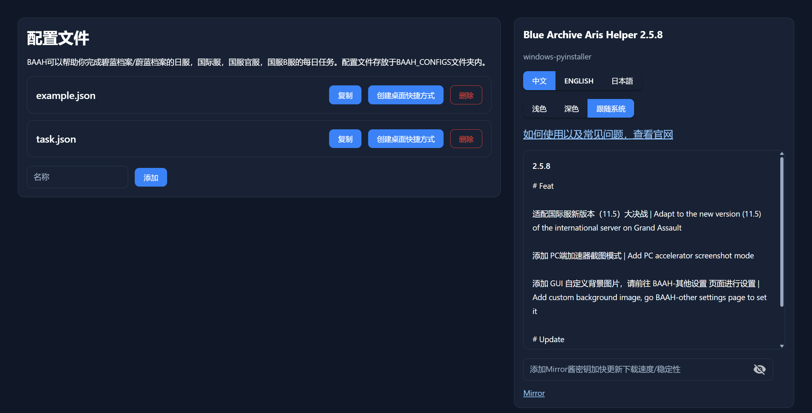

接下来只讲可能需要自己手动修改的部分，其他内容可以遵从默认值，或根据需要调整。

配置修改后，**务必点击右上角的“保存”按钮**，将内容持久化到 `task.json` 文件中。

### 基本配置

顶部栏可以配置服务器，ADB 端口以及模拟器路径，请根据你的实际情况修改。

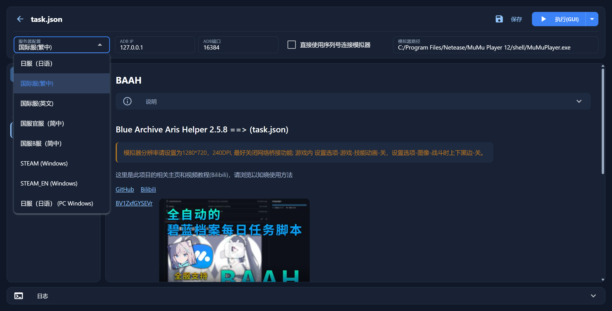

这里我服务器选择了“国际服（繁中）”，ADB 端口保持默认，模拟器路径填入了 MuMu 模拟器的安装路径。

### 任务执行顺序

在这里配置任务的执行顺序，顺序要求并不严格，可以根据自己实际游玩时的偏好调整。

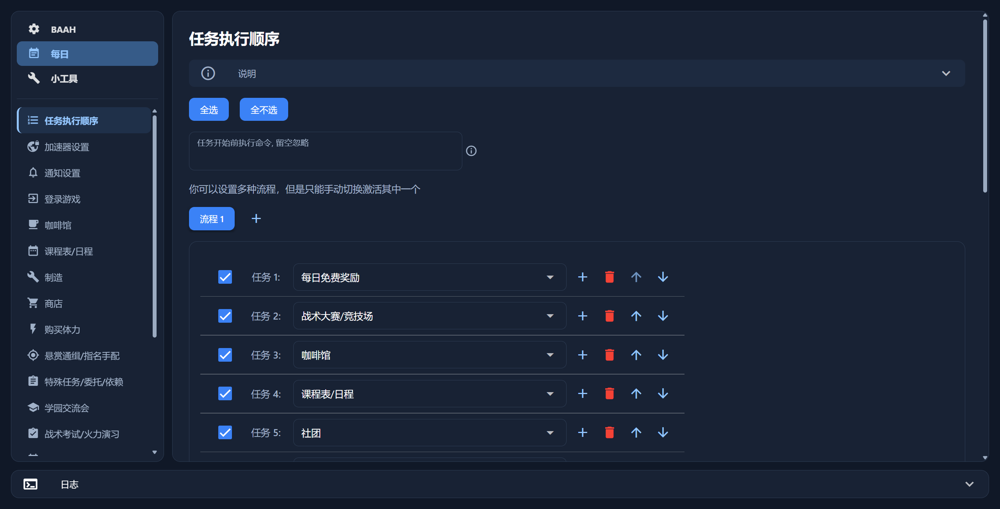

每天调用前也可以根据实际情况调整部分任务的启停状态。例如新活动开启时，如果想要手动完成剧情，以及搭配获取最高效率的编队，可以临时关闭“活动关卡”，可选关闭“普通图扫荡”以便有体力去完成活动任务关卡。又如每期的活动奖励已经获取完毕后，可以关闭“活动关卡”，将剩余的体力留给普通图扫荡。

### 加速器设置

在这里配置自动启动 UU 加速器，并模拟点击界面中的“加速”按钮，实现自动启动游戏加速功能。

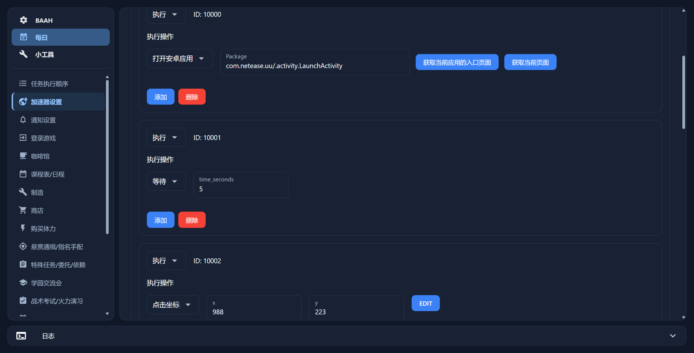

配置时只需要在 MuMu 模拟器中打开并切换到 UU 加速器标签页，然后在 BAAH 页面中点击“获取当前应用的入口页面”，就能自动填写“打开安卓应用”的应用 ID 了。

添加等待指令，确保 UU 加速器渲染完毕。

在 BAAH 页面中配置执行“点击坐标”操作，点击“EDIT”按钮，在 BAAH 提供的应用截图上右键点击“加速”按钮所在的位置，便能自动填写坐标了。

### 悬赏通缉/指名手配

消耗每天的悬赏通缉配额，一共有 3 个可选地点，因此就按 3 天一轮，每天去完成一个地点的悬赏通缉任务。

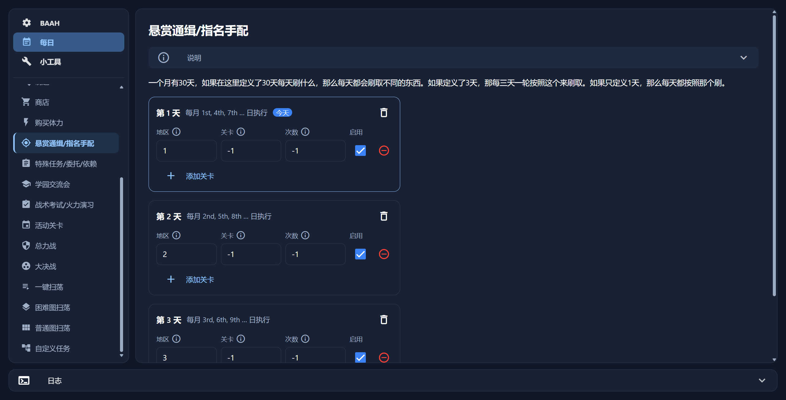

### 特殊任务/委托/依赖

每周任务要求完成 15 次特殊任务，特殊任务奖励分为经验值和信用币两种，作为长草期的大老师往往不缺信用币，所以可以配置总是刷取经验值特殊任务（对应委托 1），每天完成 3 次。

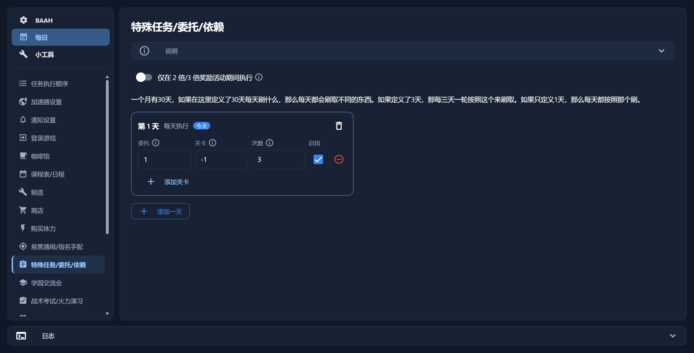

### 学园交流会

与悬赏通缉类似，学园交流会也有 3 个可选学园，因此就按 3 天一轮，每天去完成一个学园的交流会任务。

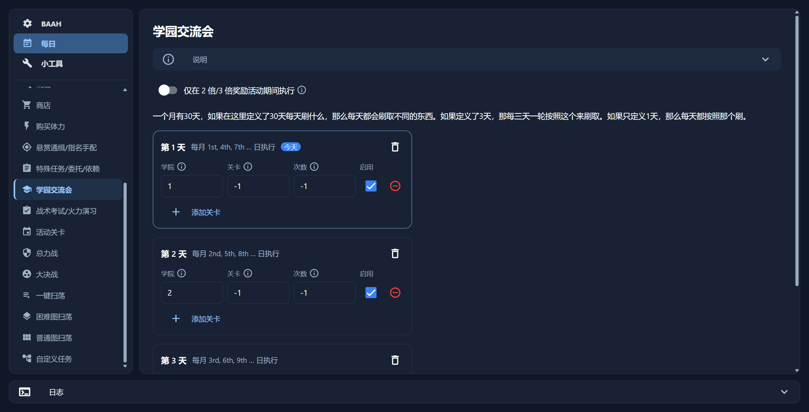

### 活动关卡

活动任务开放且奖励尚未农完时，应该优先将多余的体力消耗在活动关卡上，在这里配置最大次数扫荡指定地图。一般来说活动关卡的 10、11、12 关分别对应一种兑换奖励的代币，因此在这里按 3 天一轮，每天去扫荡一个活动关卡。

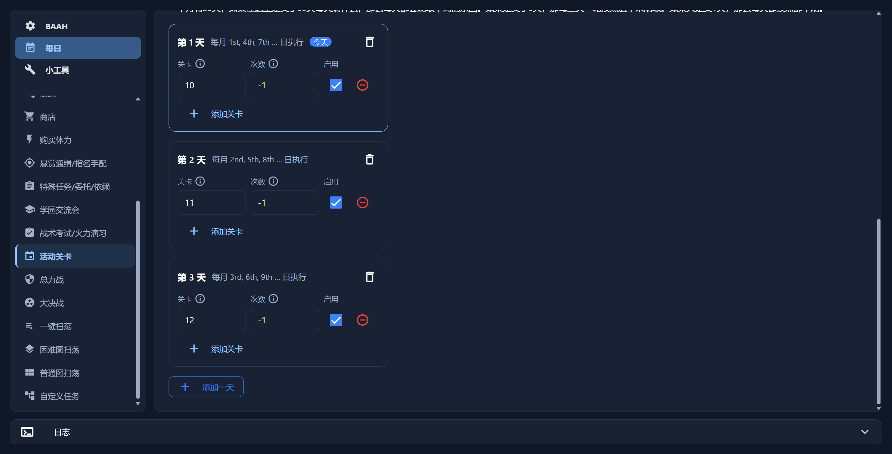

### 困难图扫荡

每日任务要求完成 3 次困难地图，在这里配置扫荡困难图的计划，请根据自己需要的学生神明文字填写对应地区与关卡。

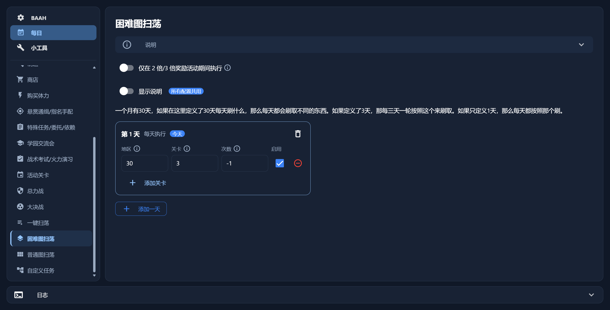

这里我就简单配置为每天自动打 3 次地区 30 的第 3 个关卡。

### 普通图扫荡

最后是普通图扫荡，如果没有其他消耗剩余体力的规划，那么可以在这里配置最大次数扫荡指定地图。考虑到新的游戏减负已经让普通图掉落通用的装备碎片，所以根据自己缺少的是技能升级素材，还是装备合成素材，对应配置扫荡最新的地图就好。

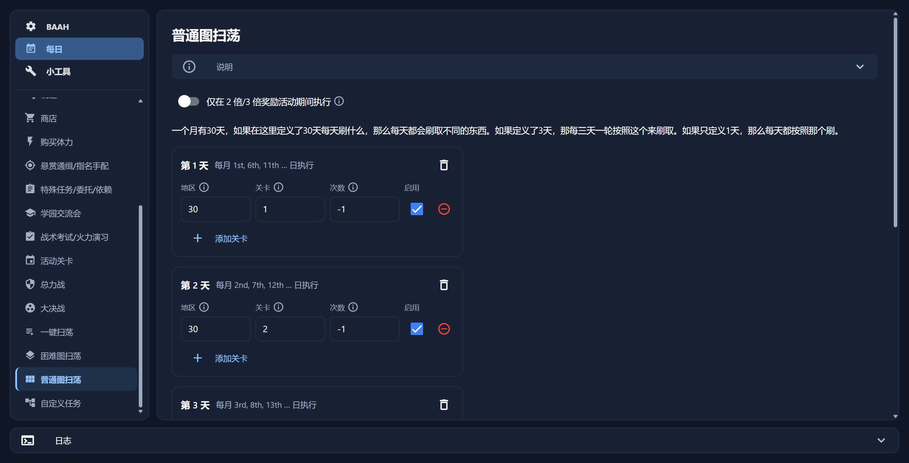

这里我配置为每 5 天一轮，每天去扫荡地区 30 的对应关卡。

## 开始自动化日常

基本的日常化任务方案已就绪，别忘了右上角“保存”任务配置。

点击右上角的“执行(GUI)”按钮，BAAH 就会透过 ADB，在 MuMu 模拟器上模拟点击，实现自动化日常。

期间如果遇到任何问题，对应修改任务规划，或调整顺序即可。

## 尾声

u1s1，BAAH 作为前 AI 时代搓出来的工具确实有它的局限性，表现在 UI 界面不那么对味，交互上也存在或多或少的不便之处，有种填写国企历史遗留系统表单的感觉。但一切理解完毕并配置好后，它确乎能跑起来自动化我的日常，这便足矣。

社区中还有另一款 [BAAS](https://github.com/pur1fying/blue_archive_auto_script) 软件，能实现相似的自动化功能，UI 设计更加现代化，还另外针对总力战等高难挑战场景进行了特化。不过看官方文档，由于曾被举报导致软件遭遇封禁，后来便没有在 Github 上发布构建后的安装包了。想用的话需要加群获取安装包，不想加群的话得自行克隆仓库构建。不过都并非难事儿，有需求的朋友不妨去试用试用。
