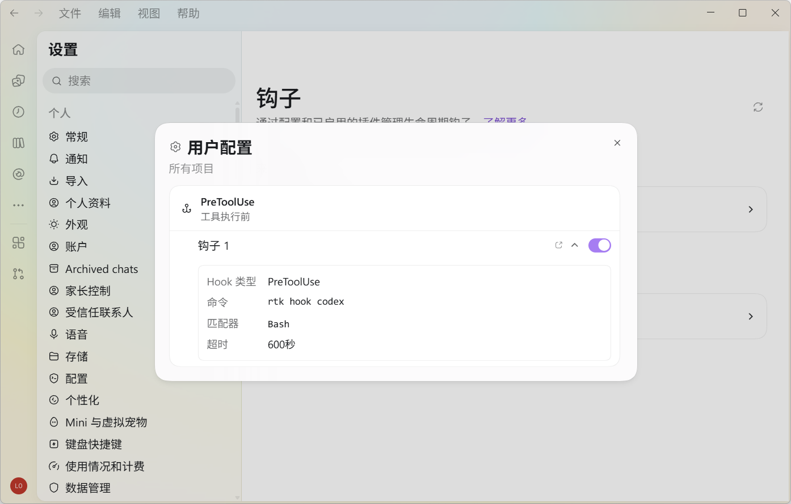
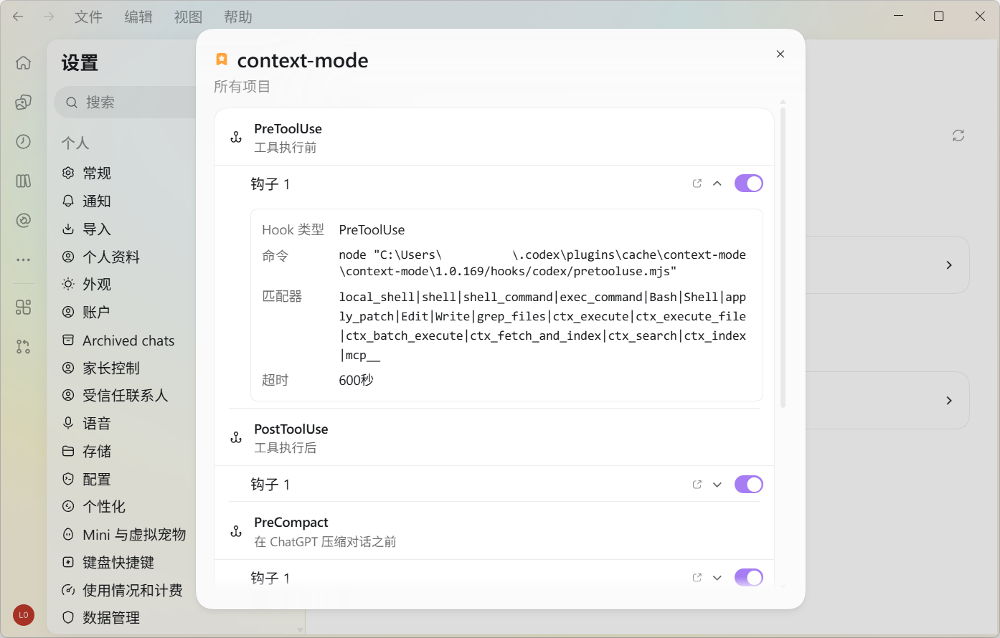
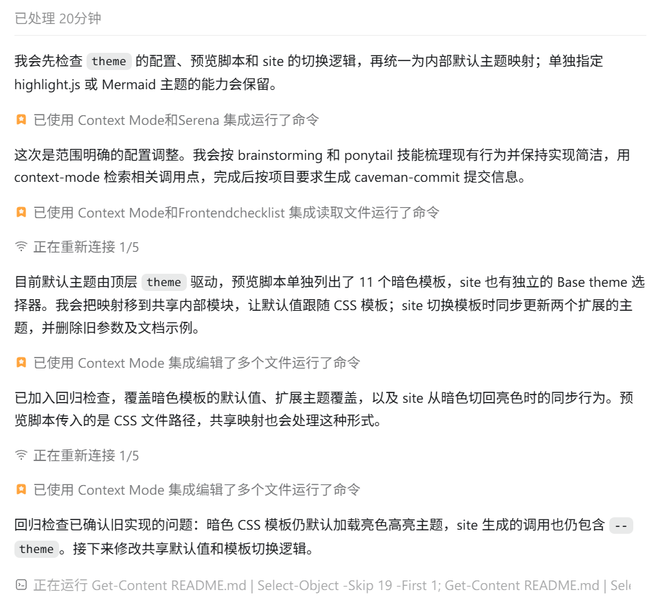
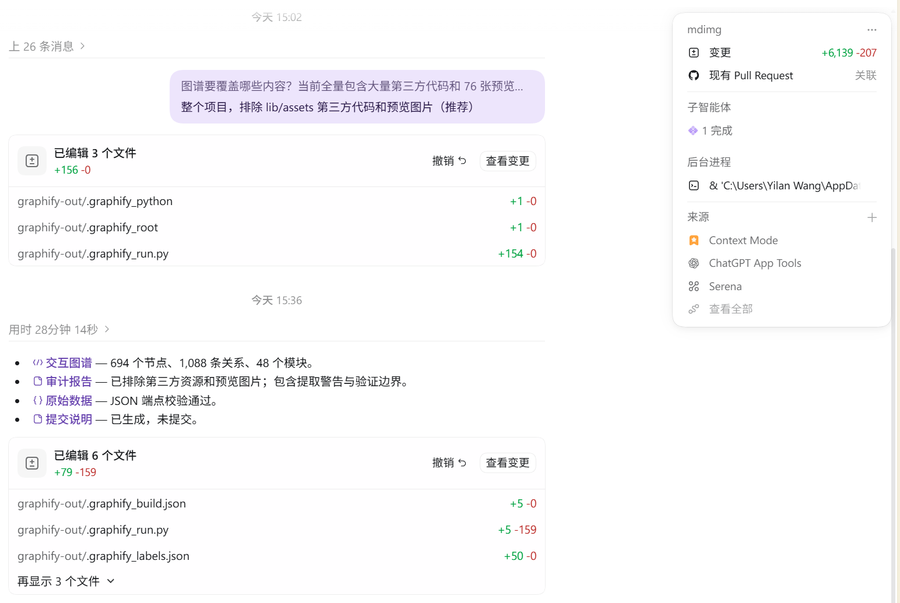

作为 AI 大模型时代里的一位普通开发者，控制好与智能体的聊天上下文无疑是涵盖省钱和提效于一体的重要技能。

受 Tibo 隔三差五就 Reset 一次套餐用量的性感人格吸引，我也终于成为了一名 ChatGPT Plus 订阅用户。本文就用来介绍，我是如何通过社区里的开源工具与服务减少 Codex 词元消耗，提升上下文利用效率的。正可谓，一次折腾，“终身”受益。

## RTK - 命令层压缩 CLI 执行结果

[RTK](https://github.com/rtk-ai/rtk) 在智能体与底层 shell 之间建立代理层，拦截并过滤终端命令（如 `git diff`、`npm test` 等）的原始输出，能够有效压缩终端命令输出的原本设计给人类阅读的各种噪音和冗长文本。

参考官方文档安装 `rtk`，对于 Windows 系统而言，执行：

```bash
winget install rtk-ai.rtk
```

安装到 Codex：

```bash
rtk init -g --codex
```

启用 RTK 塞进来的钩子：



可以在 Git 仓库里亲身感受一下 RTK 的能力：

```bash
$ git log -n 3 
commit d61cc85d725d4c349513f2e04424bc5541abb2d5 (HEAD -> main, origin/main, origin/HEAD)
Author: Lolipop <42314340+LolipopJ@users.noreply.github.com>
Date:   Tue Oct 13 09:01:55 2026 +0800

    chore: fix options

commit 811476fee469d07534200dc12b624c5f5687dc4e
Author: Lolipop <42314340+LolipopJ@users.noreply.github.com>
Date:   Tue Oct 13 09:01:07 2026 +0800

    style(theme): add 2 color-inspired themes & fix lint

commit 45b5f1fec2de1c07adfd2d9121d0aa6861c5cf1d
Author: Lolipop <42314340+LolipopJ@users.noreply.github.com>
Date:   Mon Oct 12 14:54:41 2026 +0800

    docs(preview): display preview images
$ rtk git log -n 3
d61cc85 chore: fix options (5 hours ago) <Lolipop>
811476f style(theme): add 2 color-inspired themes & fix lint (5 hours ago) <Lolipop>
45b5f1f docs(preview): display preview images (23 hours ago) <Lolipop>
```

如是，智能体在调用 RTK 代理的命令时，能显著压缩信息量，进而提升上下文利用率。

有事没事可以看看 RTK 帮忙节省了多少词元：

```bash
$ rtk gain --daily

D Daily Breakdown (5 dailys)
══════════════════════════════════════════════════════════════════════════
Date            Cmds      Input     Output      Saved   Save%     Time
──────────────────────────────────────────────────────────────────────────
2026-10-09        33     207.2K      11.9K     195.3K   94.3%     2.9s
2026-10-10        25      65.9K        182      65.7K   99.7%     1m0s
2026-10-11        59      43.3K        555      42.8K   98.7%    40.1s
2026-10-12         2          0          0          0    0.0%     1.2s
2026-10-13        83     879.4K      49.6K     829.8K   94.4%    10.9s
──────────────────────────────────────────────────────────────────────────
TOTAL            202       1.2M      62.2K       1.1M   94.8%    24.2s
```

## Context Mode - 会话层摘要大数据

[Context Mode](https://github.com/mksglu/context-mode) 通过 Hook 机制拦截工具调用，将原始数据（如网页快照、日志、API 响应）隔离在子进程中处理，仅将极小的结果返回给 LLM。

面对大量数据时，LLM 一般会一股脑照读原始数据生成结果。Context Mode 旨在优化这个默认行为，新的范式是：检测到工具调用目标是大文件或大输出时，强制要求 LLM 写一个处理脚本，在沙盒中处理这些数据，最终得到一份摘要放入上下文中。

由于会额外调用 LLM 生成摘要算法来处理数据，使用此能力时会增加会话的时间，但对于保持上下文大小健康，减少压缩命令调用来说很有帮助。

在 Codex 的插件市场中添加 `mksglu/context-mode` 并安装，然后像启用 RTK 的钩子一样，允许 Context Mode 塞进来的所有钩子即可：



接下来执行任务时，就大概率能看到 Context Mode 的身影了：



在一天的工作任务结束后，不妨抽空向智能体发送命令，看看 Context Mode 的表现如何：

```plaintext
> ctx stats

Across 1 day you ran 12 conversations in Codex CLI.

4.6M tokens saved  ·  99.4% reduction  ·  2h 46m  ·  ~$23.08 saved (Opus)

Without context-mode  |████████████████████████████████████████| 17.7 MB
With context-mode     |█░░░░░░░░░░░░░░░░░░░░░░░░░░░░░░░░░░░░░░░| 108 KB

17.6 MB kept out of your conversation — 168× longer sessions before compact.

24 calls

  ctx_execute               18 calls    8.8 MB saved
  ctx_batch_execute          4 calls    6.4 MB saved
  ctx_search                 2 calls    2.4 MB saved

  All your work  ·  745 events captured across 6 projects  ·  12 conversations

  External docs indexed        118   ██████████████████████████████
  MCP tools called             118   ██████████████████████████████
  mcp_tool_call                118   ██████████████████████████████
  Errors caught                 94   ████████████████████████░░░░░░
  Constraints you set           86   ██████████████████████░░░░░░░░
  Files tracked                 79   ████████████████████░░░░░░░░░░
  sandbox                       51   █████████████░░░░░░░░░░░░░░░░░
  Project rules (CLAUDE.md)     24   ██████░░░░░░░░░░░░░░░░░░░░░░░░
  Git operations                19   █████░░░░░░░░░░░░░░░░░░░░░░░░░
  Your messages remembered      13   ███░░░░░░░░░░░░░░░░░░░░░░░░░░░
  Session intent                 9   ██░░░░░░░░░░░░░░░░░░░░░░░░░░░░
  session                        8   ██░░░░░░░░░░░░░░░░░░░░░░░░░░░░
  Data references                2   █░░░░░░░░░░░░░░░░░░░░░░░░░░░░░
  cost                           2   █░░░░░░░░░░░░░░░░░░░░░░░░░░░░░
  Your decisions                 2   █░░░░░░░░░░░░░░░░░░░░░░░░░░░░░
  Environment setup              2   █░░░░░░░░░░░░░░░░░░░░░░░░░░░░░

Where it came from (tools you actually used — fixtures + probes filtered):

  Tool              Captures   Indexed  Total kept out
  Codex CLI              745    1.3 MB          1.3 MB

─────────────────────────────────────────────────────────────────
Your AI talks less, remembers more, costs less.
$23.08 this session  ·  $24.04 lifetime
─────────────────────────────────────────────────────────────────

v1.0.169
```

不得不说，光是看到都觉得赏心悦目的数值。

## Headroom - 通用上下文内容压缩

[Headroom](https://github.com/headroomlabs-ai/headroom) 是一个代理工具，它在数据最终发送给 LLM 之前的最末端进行拦截，将数据处理压缩之后，再发往 LLM。它覆盖所有的上下文内容，不仅包括工具输出，还包括日志（Logs）、RAG 检索片段、大文件内容以及对话历史等。

Headroom 采用「规则与结构化算法优先，机器学习模型按需参与」的混合架构，在内部对数据进行结构识别，如果是结构化数据，则交给算法进行压缩，如果是非结构化数据，则交给内部小模型选择与压缩。

### 使用 Docker 部署 Headroom 在远程服务器上

出于种种考虑，我决定将 Headroom 部署在远程服务器上，而不是本地。优点在于拥有了在任何国内网络环境访问 ChatGPT 服务的能力，缺点是速度受公网服务器带宽影响，部署流程也更加折腾。

添加 Docker compose 配置文件 `path/to/headroom-docker/docker-compose.yaml`：

```yaml
services:
  cli:
    image: ${HEADROOM_IMAGE:-ghcr.io/headroomlabs-ai/headroom:latest}
    entrypoint: ['headroom']
    working_dir: /workspace
    stdin_open: true
    tty: true
    environment:
      HOME: /tmp/headroom-home
      HEADROOM_WORKSPACE_DIR: /tmp/headroom-home/.headroom
      HEADROOM_CONFIG_DIR: /tmp/headroom-home/.headroom/config
    volumes:
      - ${HEADROOM_WORKSPACE:-.}:/workspace
      - ${HEADROOM_HOST_HOME:?set HEADROOM_HOST_HOME}/.headroom:/tmp/headroom-home/.headroom
      - ${HEADROOM_HOST_HOME:?set HEADROOM_HOST_HOME}/.claude:/tmp/headroom-home/.claude
      - ${HEADROOM_HOST_HOME:?set HEADROOM_HOST_HOME}/.codex:/tmp/headroom-home/.codex
      - ${HEADROOM_HOST_HOME:?set HEADROOM_HOST_HOME}/.gemini:/tmp/headroom-home/.gemini
    command: ['--help']

  proxy:
    image: ${HEADROOM_IMAGE:-ghcr.io/headroomlabs-ai/headroom:latest}
    entrypoint: ['headroom', 'proxy']
    working_dir: /workspace
    restart: unless-stopped
    environment:
      HOME: /tmp/headroom-home
      HEADROOM_HOST: 0.0.0.0
      HEADROOM_PROXY_TOKEN: ${HEADROOM_PROXY_TOKEN:-}
      HEADROOM_ALLOW_UNAUTHENTICATED_BIND: '1'
      HEADROOM_WORKSPACE_DIR: /tmp/headroom-home/.headroom
      HEADROOM_CONFIG_DIR: /tmp/headroom-home/.headroom/config
    ports:
      - '${HEADROOM_PORT:-8787}:${HEADROOM_PORT:-8787}'
    volumes:
      - ${HEADROOM_WORKSPACE:-.}:/workspace
      - ${HEADROOM_HOST_HOME:?set HEADROOM_HOST_HOME}/.headroom:/tmp/headroom-home/.headroom
      - ${HEADROOM_HOST_HOME:?set HEADROOM_HOST_HOME}/.claude:/tmp/headroom-home/.claude
      - ${HEADROOM_HOST_HOME:?set HEADROOM_HOST_HOME}/.codex:/tmp/headroom-home/.codex
      - ${HEADROOM_HOST_HOME:?set HEADROOM_HOST_HOME}/.gemini:/tmp/headroom-home/.gemini
    command: ['--host', '0.0.0.0', '--port', '${HEADROOM_PORT:-8787}']
```

这里，我按照官方文档的介绍，直接用了项目仓库里的 [`docker/docker-compose.native.yml`](https://github.com/headroomlabs-ai/headroom/blob/0126fba63f5af3c8022085d0d033dce56fe5db65/docker/docker-compose.native.yml)。唯一作了变更的位置是 `proxy` 服务的 `ports` 配置，官方文件的 `- "127.0.0.1:${HEADROOM_PORT:-8787}:${HEADROOM_PORT:-8787}"` 仅限本机访问，而为了让其他服务器访问，我把它修改为了 `- "${HEADROOM_PORT:-8787}:${HEADROOM_PORT:-8787}"`。

在同目录下创建环境变量文件 `path/to/headroom-docker/.env`：

```bash
HEADROOM_HOST_HOME=path/to/user-root # 一般设为 $HOME
HEADROOM_WORKSPACE=path/to/headroom-workspace
HEADROOM_PROXY_TOKEN=YOUR-HEADROOM-SECRET-TOKEN # Headroom 访问密匙，避免别人知道你的服务器地址而发起的未授权访问
```

启动 Headroom 容器服务：

```bash
docker-compose up -d proxy
```

检验 Headroom 容器服务是否正确启动：

```bash
$ curl http://localhost:8787/health
{"service":"headroom-proxy","status":"healthy","ready":true,"version":"0.40.0","timestamp":"2026-10-13T04:42:11.658753Z","uptime_seconds":60476.59,"checks":{"startup":{"enabled":true,"ready":true,"status":"healthy","error":null},"http_client":{"enabled":true,"ready":true,"status":"healthy"},"cache":{"enabled":true,"ready":true,"status":"healthy"},"rate_limiter":{"enabled":true,"ready":true,"status":"healthy"},"memory":{"enabled":false,"ready":true,"status":"disabled","backend":null,"initialized":false,"native_tool":false,"bridge_enabled":false},"upstream":{"enabled":true,"ready":true,"status":"healthy","url":"https://api.anthropic.com","error":null},"kompress":{"enabled":true,"ready":true,"status":"healthy","optional":true,"backend":"onnx"}},"runtime":{"anthropic_pre_upstream":{"enabled":true,"resolved_concurrency":8,"source":"auto","acquire_timeout_seconds":15.0,"compression_timeout_seconds":30.0,"memory_context_timeout_seconds":2.0,"codex_ws_gated":false},"compression_executor":{"max_workers":10,"queued":0,"queued_max":2,"queue_timeouts_total":0,"queue_wait_seconds_total":0.09277528757229447,"queue_wait_seconds_max":0.0018117078579962254,"running":0,"in_flight":0,"in_flight_max":3,"run_seconds_total":153.0369739527814,"run_seconds_max":6.425426128320396,"leaked_threads_total":0,"quarantine_active":false,"timed_out_workers":0,"timed_out_workers_max":0,"quarantine_activations_total":0,"quarantine_skips_total":0,"source":"auto"},"websocket_sessions":{"active_sessions":0,"active_relay_tasks":0}},"rust_core":"loaded"}%
```

根据实际情况，配置网络转发。例如，我的 Headroom 容器服务部署在家用服务器上，需要在另一个软路由服务器上配置 frp 客户端建立到公网服务器的 TCP 隧道，最后在公网服务器上使用 Nginx 反向代理域名请求到对应的 frp 服务端监听端口，最终实现内网穿透。

验证内网服务是否能正常访问，在主机上执行：

```bash
PS C:\Users\XXX> curl https://headroom.example.com/health


StatusCode        : 200
StatusDescription : OK
Content           : {"service":"headroom-proxy","status":"healthy","ready":true,"version":"0.40.0","timestamp":"2026-10
                    -13T04:45:03.999264Z","uptime_seconds":60648.931,"checks":{"startup":{"enabled":true,"ready":true,"
                    st...
RawContent        : HTTP/1.1 200 OK
                    Connection: keep-alive
                    vary: Origin
                    x-content-type-options: nosniff
                    x-frame-options: DENY
                    referrer-policy: no-referrer
                    strict-transport-security: max-age=31536000; includeSubDoma...
Forms             : {}
Headers           : {[Connection, keep-alive], [vary, Origin], [x-content-type-options, nosniff], [x-frame-options, DEN
                    Y]...}
Images            : {}
InputFields       : {}
Links             : {}
ParsedHtml        : mshtml.HTMLDocumentClass
RawContentLength  : 1541
```

### 配置 Codex 访问 Headroom 代理

现在，我们需要将 Codex 原本要发送到 `https://api.openai.com/v1` 的请求替换到 Headroom 服务上。

编辑 Codex 的配置文件 `~/.codex/config.toml`：

```toml
model_provider = "headroom"

[model_providers.headroom]
name = "Headroom Proxy"
base_url = "https://headroom.example.com/v1" # 替换为你的域名地址
wire_api = "responses"
requires_openai_auth = true

[model_providers.headroom.http_headers]
X-Headroom-Proxy-Token = "YOUR-HEADROOM-SECRET-TOKEN" # 替换为环境变量中定义的 Headroom 访问密匙
```

在一次完完整整地在实际项目开发中用完 Plus 的 5h 限额后，打印 Headroom 节省的词元统计信息如下：

```bash
$ docker exec headroom-proxy-1 headroom savings

Today        ██░░░░░░░░░░░░░░  14.3%  saved 1,974,114 / 13,793,114 tokens  $4.2465  · of new input 64.5%
Last 7 days  ██░░░░░░░░░░░░░░  14.3%  saved 1,974,477 / 13,814,757 tokens  $4.2472  · of new input 64.0%
Last 30 days ██░░░░░░░░░░░░░░  14.3%  saved 1,974,477 / 13,814,757 tokens  $4.2472  · of new input 64.0%
  % is of all forwarded input (cached history recounted every turn); 'of new input' is of tokens that newly entered context.

Cost avoided per model:
  gpt-6.1-sol              $3.8514
  gpt-6-astra              $0.3745
  gpt-5.6-terra            $0.0213
  gpt-6-luna               $0.0001
  gpt-5.6-luna             $0.0000
  codex-auto-review        $0.0000

  note: Some events are priced at flat list price: either they predate cache-aware pricing or their provider reported no cache breakdown. The real saving is likely LOWER.

Savings by client:
  codex                    162 calls · 1,974,477 tokens saved
```

当然，在远程也可以执行 `curl -H "X-Headroom-Proxy-Token: YOUR-HEADROOM-SECRET-TOKEN" https://headroom.example.com/stats` 来获取统计信息。

## Caveman - 减少 LLM 生成的废话

[Caveman](https://github.com/juliusbrussee/caveman) 让 LLM 用最直白、最直接、最不绕弯子的方式进行回复，而且的确不在自己的回复塞形如“我会用最直白、最直接、最不绕弯子的方式直接告诉你答案”的废话。

直接将 Caveman 技能安装到全局：

```bash
npx skills add JuliusBrussee/caveman -g
```

现在 Codex 就会根据情况自动判断什么时候调用 Caveman 提供的技能；我个人则会乐意在 `~/.codex/AGENTS.md` 里补充一句话：

```md
- After every coding task, use caveman-commit skill to generate a commit message.
```

这样，在每次编程任务结束后，Codex 会根据 `caveman-commit` 技能，自动生成一个 Git 提交信息。例如某次任务结束后，得到的摘要消息为：

````plaintext
已更新 test.md：补齐常用 Markdown 语法，加入八种语言的完整正文，并充实图文区域。

浅色、深色渲染检查通过，无横向溢出；默认测试 14 个套件、778 项全部通过。

```plaintext
test: expand multilingual Markdown fixture
```
````

Caveman 如今也支持代理的安装方式，配置好后能像其他工具一样查看节省的词元数。由于我没有采用这种使用方式，所以不在此文赘述。

## Graphify - 帮助智能体更快理解项目

[Graphify](https://github.com/Graphify-Labs/graphify) 的核心能力是将任意代码库及多模态资料自动转化为可查询的知识图谱，让智能体和开发者能像查阅地图一样「先全局后局部」理解项目全貌，而非盲目地逐文件搜索，达到优化上下文大小的目的。

Graphify 采用与 Headroom 相似的「确定性解析 + 语义推断」的混合架构。第一轮：纯算法本地解析，使用 Tree-sitter 等语法解析器处理代码文件，提取类、函数、导入关系、调用链等明确写在代码里的结构。第二轮：AI 语义提取，对文档、论文、图片和视频等非结构化数据调用 LLM 进行概念识别和关系推断。

在系统中安装 Graphify：

```bash
uv tool install graphifyy # 末尾多的 y 并非拼写错误
```

安装到 Codex：

```bash
graphify install --platform codex
```

在 Codex 聊天页面调用命令：

```plaintext
> /graphify .
```

执行的结果形如：



运行后在项目根路径下生成知识图谱目录 `graphify-out/`，其中 `graphify-out/graph.json` 是供智能体查阅关系树的元数据文件。

打开 `graphify-out/graph.html` 可以看到可视化的有向图：


作为参考，我一般将如下内容添加到 `.gitignore` 中：

```bash
# Graphify
graphify-out/cache/**
graphify-out/.graphify_python
graphify-out/.graphify_root
graphify-out/BENCHMARK.txt
graphify-out/COMMIT_MESSAGE.txt
graphify-out/cost.json
graphify-out/diagnostics.json
```

Graphify 生成的知识图谱是静态的，若项目结构或代码大改，需重新执行生成命令，否则会知识图谱可能过期。在生产实践中，往往把它和社区中另一个工具 [Serena](https://github.com/oraios/serena) 协同使用。

Serena 是一个基于 LSP（Language Server Protocol，语言服务器协议）的语义导航与编辑工具，相当于把 IDE 底部的代码智能引擎直接接给了智能体。它不存储离线的图，而是通过实时的语言服务器去精确查找符号定义、引用，并让智能体进行跨文件的精确重构、重命名和符号级编辑。

## 尾声

实际上，社区已经有项目打包了涵盖本文提到的在内，一系列用于减少词元消耗的插件与服务，使用这些项目理论上能更快实现相似甚至更好的词元节省效果。不过作为一个从旧时代走过来的程序员，天生会对此类封装抱持怀疑，会否会如过去很多开发框架一样因过度封装反而容易遇到一些难题无法解决？在真正出现经受验证、缺你不可的工具之前，就让我保持对这些基础设施的可支配感吧。

最后，你可能也注意到了，此类上下文压缩工具或服务的实现都或多或少基于有损的“信息提炼与过滤”，我们预期它们总是保留对 LLM 来说最有用的“核心信号”，但从理性的角度来讲这又是不可能的。因此，启用的工具并不是越多就越好的，一方面要衡量时间和效率的性价比，另一方面也要避免“过拟合”导致信息失真。嚯嚯，这恐怕也是此类工具的门道所在吧。
